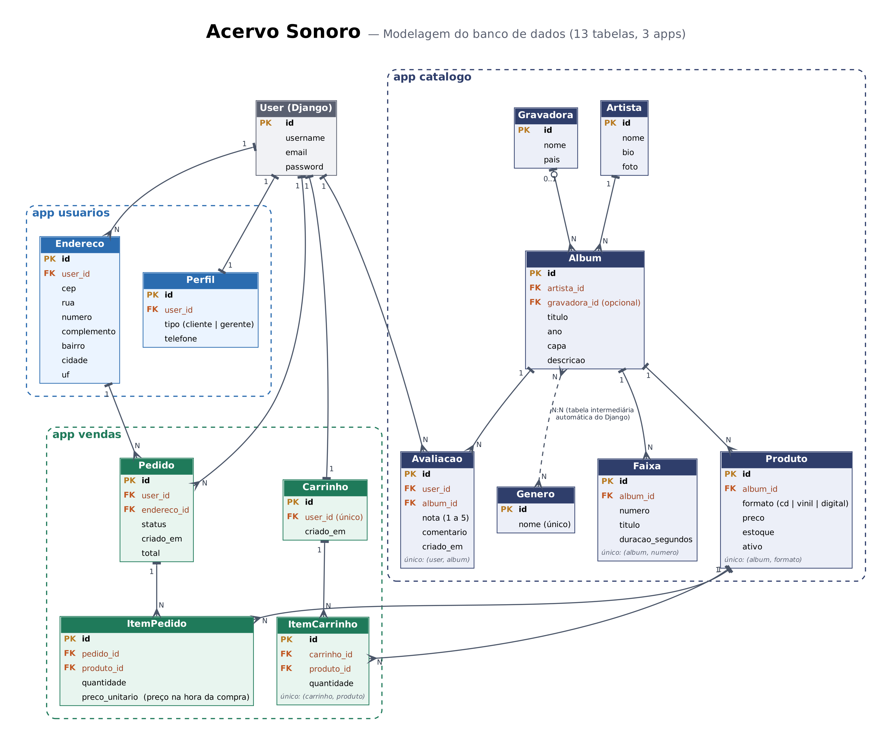

# Acervo Sonoro - Loja de CDs e Álbuns

Loja virtual de CDs e álbuns musicais, com catálogo, carrinho e pedidos para clientes e gestão de estoque para administradores.

Trabalho prático da disciplina GAC116 - Programação Web da Universidade Federal de Lavras (UFLA).

## Integrantes

* Gabriel Moraes de Oliveira
* Arthur Catarino Oliveira
* Luiz Felipe de Souza Marques

## Tecnologias Utilizadas

* Python 3 e Django 6 (arquitetura MVT)
* SQLite (banco de dados relacional)
* Bootstrap 5.3 e FontAwesome (interface responsiva, com tema claro e escuro)
* Django Jazzmin (tema do ambiente administrativo)
* SeaweedFS (armazenamento das imagens, via API S3) com django-storages e boto3
* Docker Compose, WhiteNoise, Pillow e python-dotenv

## Principais Funcionalidades

* Catálogo de álbuns com artistas, gêneros, gravadoras, faixas e capas
* Venda do mesmo álbum em vários formatos (CD, vinil e digital), cada um com preço e estoque próprios
* Carrinho, pedidos com status e avaliações de álbuns
* Perfis de cliente e gerente, com permissões distintas
* Ambiente administrativo com filtros e busca para todas as entidades
* Cadastro, login e logout, catálogo, carrinho e pedidos para o cliente

### Acesso

* Cadastro de usuário (com e-mail e telefone opcionais), que já faz o login e cria o perfil de cliente
* Login e logout (o logout só aceita POST)
* Páginas de conta, carrinho, pedidos e avaliação exigem login
* Ao acessar uma página protegida sem login, o usuário vai para o login e, depois de entrar, volta à página original (parâmetro `next`)

### Conta

* Cadastro, listagem, edição e exclusão de endereços de entrega
* Endereço vinculado a algum pedido não pode ser editado nem excluído

### Catálogo

* Página inicial com os últimos álbuns, os mais bem avaliados e os gêneros
* Vitrine de álbuns com busca por título ou artista, filtros por gênero, artista e formato, ordenação (recentes, título, menor preço, nota) e paginação de 9 em 9
* Detalhe do álbum com faixas e duração, formatos disponíveis (preço e estoque) e avaliações com nota média
* O usuário logado pode avaliar o álbum (nota de 1 a 5 e comentário), alterar ou remover a própria avaliação

### Vendas

* Carrinho: adicionar, alterar quantidade e remover itens, sempre respeitando o estoque
* Checkout com escolha do endereço, feito em transação atômica: o preço de cada item fica gravado no pedido (`preco_unitario`), o estoque é baixado e o carrinho é esvaziado; se faltar estoque, nada é gravado
* Meus pedidos: lista e detalhe dos pedidos do usuário
* Cancelamento de pedido pendente, com devolução do estoque

### Administração

* Gerenciamento de todos os modelos pelo ambiente administrativo (tema Jazzmin), com filtros e busca
* Álbum com faixas e produtos editados na mesma tela; preço e estoque editáveis direto na lista de produtos
* Ações em lote para marcar pedidos como pago ou enviado (pedidos cancelados não são alterados)
* Perfil editado junto com o usuário

## Perfis e Permissões

Cada usuário tem um `Perfil` (criado automaticamente ao criar o usuário) com o tipo **cliente** ou **gerente**. Superusuários começam como gerente; os demais, como cliente.

O `migrate` cria (ou atualiza) os grupos:

| Grupo | Permissões |
|-------|------------|
| Gerente | Todas as permissões do app `catalogo` (artistas, gêneros, gravadoras, álbuns, faixas, produtos e avaliações); ver e alterar pedidos e itens de pedido; ver perfis, endereços e usuários |
| Cliente | Nenhuma permissão no admin; usa apenas a loja |

Ao salvar um `Perfil`, o usuário é colocado no grupo correspondente e o `is_staff` é ajustado: gerente recebe `is_staff=True` e acessa o admin; cliente fica com `is_staff=False` (exceto superusuário).

## Modelo de Dados

São 13 tabelas distribuídas em 3 apps, além do `User` do Django.

| Entidade | App | Relacionamentos |
|----------|-----|-----------------|
| Perfil | usuarios | 1:1 com User |
| Endereco | usuarios | N:1 com User |
| Artista | catalogo | 1:N com Album |
| Gravadora | catalogo | 1:N com Album (opcional no álbum) |
| Genero | catalogo | N:N com Album |
| Album | catalogo | N:1 com Artista e Gravadora; N:N com Genero |
| Faixa | catalogo | N:1 com Album (número único por álbum) |
| Produto | catalogo | N:1 com Album (um por formato: CD, vinil ou digital) |
| Avaliacao | catalogo | N:1 com User e Album (uma por usuário e álbum) |
| Carrinho | vendas | 1:1 com User |
| ItemCarrinho | vendas | N:1 com Carrinho e Produto (produto único por carrinho) |
| Pedido | vendas | N:1 com User e Endereco |
| ItemPedido | vendas | N:1 com Pedido e Produto; guarda o preço da compra |



## Instalação e Execução

A aplicação roda localmente e somente o SeaweedFS, que armazena as imagens, roda no Docker. Antes de começar, abra o Docker Desktop.

Na pasta `code` do projeto:

```bash
python3 -m venv venv
source venv/bin/activate
python3 -m pip install -r requirements.txt
cp env_sample.conf env.conf
docker compose up -d
python3 scripts-bd/cria_bucket.py
python3 manage.py migrate
python3 manage.py collectstatic --noinput
python3 manage.py createsuperuser
python3 scripts-bd/popula_loja.py
python3 manage.py runserver
```

O `popula_loja.py` já executa o `popula_catalogo.py` e completa a carga com preços, estoques, faixas, clientes, endereços e avaliações. Para carregar só o catálogo, use `python3 scripts-bd/popula_catalogo.py`. Os scripts podem ser rodados mais de uma vez.

Acesse no navegador a página [http://127.0.0.1:8000/](http://127.0.0.1:8000/). O ambiente administrativo fica em [http://127.0.0.1:8000/admin/](http://127.0.0.1:8000/admin/) e o SeaweedFS (S3) em [http://localhost:8333](http://localhost:8333).

Se o script `cria_bucket.py` der erro de conexão, o SeaweedFS ainda está iniciando. Aguarde alguns segundos e execute-o novamente.

## Usuários de Demonstração

Criados pelo `scripts-bd/popula_loja.py`, todos do tipo cliente e com endereço cadastrado:

| Usuário | Senha |
|---------|-------|
| cliente | acervo123 |
| joao | acervo123 |
| marina | acervo123 |

O superusuário criado com `createsuperuser` é gerente e também recebe um endereço, se o `popula_loja.py` for executado depois dele.

## Execuções Seguintes

Na pasta `code`:

```bash
source venv/bin/activate
docker compose up -d
python3 manage.py runserver
```

Para encerrar, pressione `Ctrl+C` e desligue o SeaweedFS:

```bash
docker compose down
```

## Armazenamento Local

Para rodar sem Docker, defina `USAR_SEAWEEDFS=False` no arquivo `env.conf` e reinicie a aplicação. As imagens passam a ser salvas na pasta `media`. Nesse caso, os comandos `docker compose` e o script `cria_bucket.py` não são necessários.

**Atenção:** As chaves de `env_sample.conf` e `seaweedfs/s3.json` são apenas para desenvolvimento. O arquivo `env.conf` não deve ser publicado.

## Testes

Na pasta `code`, com a venv ativa:

```bash
python3 manage.py test
```

## URLs Principais

| Caminho | Descrição |
|---------|-----------|
| `/` | Página inicial |
| `/albuns/` | Vitrine com busca, filtros, ordenação e paginação |
| `/albuns/<id>/` | Detalhe do álbum |
| `/albuns/<id>/avaliar/` | Salvar avaliação (POST, login) |
| `/albuns/<id>/avaliacao/excluir/` | Remover a própria avaliação (POST, login) |
| `/auth/cadastro/` | Cadastro de usuário |
| `/auth/login/` | Login |
| `/auth/logout/` | Logout (POST) |
| `/conta/enderecos/` | Meus endereços |
| `/conta/enderecos/novo/` | Novo endereço |
| `/conta/enderecos/<id>/editar/` | Editar endereço |
| `/conta/enderecos/<id>/excluir/` | Excluir endereço (POST) |
| `/carrinho/` | Carrinho |
| `/carrinho/adicionar/<produto_id>/` | Adicionar produto ao carrinho (POST) |
| `/carrinho/item/<id>/atualizar/` | Alterar quantidade (POST) |
| `/carrinho/item/<id>/remover/` | Remover item (POST) |
| `/carrinho/finalizar/` | Checkout |
| `/pedidos/` | Meus pedidos |
| `/pedidos/<id>/` | Detalhe do pedido |
| `/pedidos/<id>/cancelar/` | Cancelar pedido pendente (POST) |
| `/admin/` | Ambiente administrativo |

## Estrutura do projeto

```text
projeto-web-django/
├── README.md
├── docs/
│   └── diagrama-bd.png
├── recursos/
└── code/
    ├── manage.py
    ├── requirements.txt
    ├── docker-compose.yml
    ├── env_sample.conf
    ├── seaweedfs/
    ├── scripts-bd/
    ├── static/
    ├── templates/
    ├── acervo_sonoro/
    ├── usuarios/
    ├── catalogo/
    └── vendas/
```
